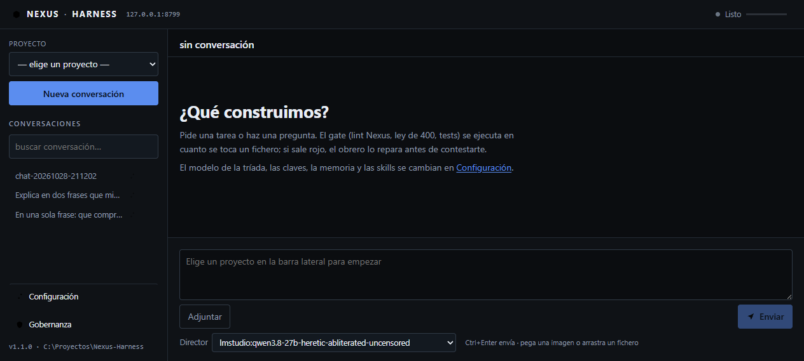
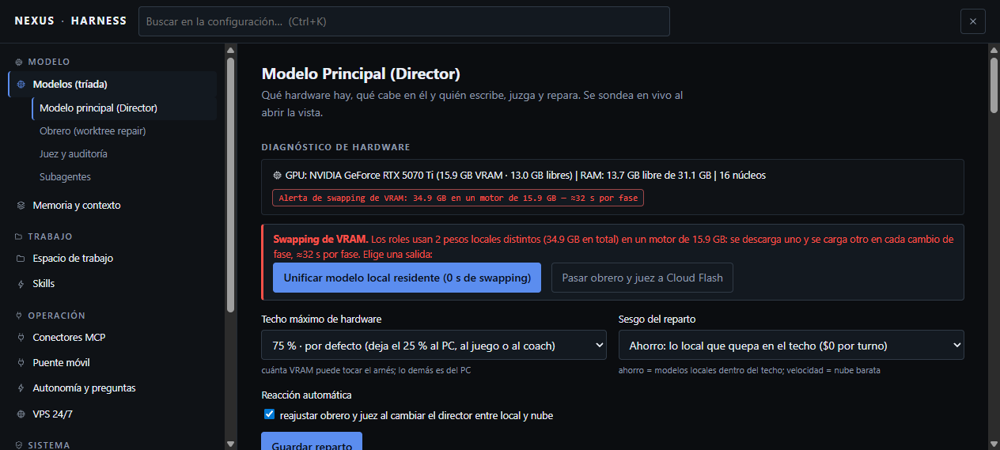
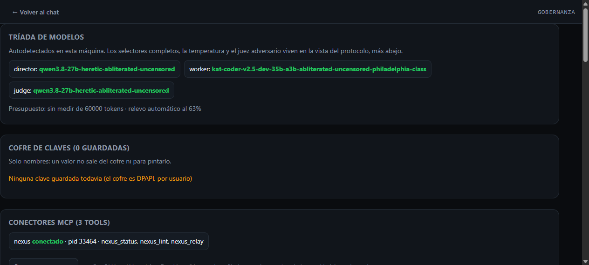

# Guía de uso de la cabina (U-09)

> Cómo se ve, se viste y se usa la cabina de Nexus-Harness. Cada cifra y cada captura que aparecen
> aquí existen: las capturas viven en `docs/ui/` y los números se leen de `/api/*` o de las suites,
> nunca se escriben a mano. Los comandos son los que el repo ya trae; ninguno se ha inventado.

La cabina es el **cuaderno de taller**: un documento técnico impreso, no un panel de tarjetas. Masthead
de una línea, índice a la izquierda y el hilo como documento. Sin azul, sin tarjetas, sin sombras: la
estructura la hacen las reglas de 1 px. La dirección de arte está escrita en `docs/DESIGN.md` y el
detalle del rework en `docs/UI_REWORK.md`.

## 1. Las tres pantallas

| pantalla | ruta | qué es | captura |
|---|---|---|---|
| Chat | `/` | el documento de trabajo: hilo con folio por mensaje, compositor reglado, índice de conversaciones |  · [hilo real](ui/after-chat-thread.png) |
| Configuración | `/settings` | el manual de operación: índice numerado §01–§12 agrupado por dominio (Modelo · Trabajo · Operación · Sistema) |  · [stats](ui/v2-settings-stats.png) |
| Gobernanza | `/gov` | **documento ajeno**: lo sirve el protocolo (NexusProtocol) con su propio acento azul. La cabina solo inyecta una barra de vuelta |  |

La configuración se explora sin script (el árbol va en el HTML servido) y también con teclado: `Ctrl+K`
abre un buscador de **destinos** (los 12 § del manual) con flechas y `Enter`. El índice de
conversaciones es un `role="listbox"`: `↑ ↓` recorren y `Enter` abre
([captura del foco](ui/u07-indice-foco.png)).

## 2. Los cinco ejes del aspecto

El aspecto no es un catálogo: son **cinco ejes independientes** que se eligen por separado en
`§10 Apariencia` (`settings_theme.py`). Cambiar uno no toca los otros. Cada eje tiene su formulario y
su `303`; se guarda en su clave y la valida `onboarding` (una errata no se escribe).

| eje | clave | valores | qué mueve | dónde vive |
|---|---|---|---|---|
| Modo (papel) | `ui_mode` | `dark`, `light` | oscuro o claro; **no** depende del sistema, lo eliges tú | `themes.css` (generado) |
| Diseño (composición) | `ui_skin` | `main`, `editorial`, `terminal`, `matrix`, `glossy` | tipografía de los títulos, rejilla, densidad y forma del mensaje | `skins.css` + `skins-special.css` |
| Pantón (color) | `ui_theme` | `neon`, `crt`, `synth`, `amber`, `riso`, `paper` | papel, tinta y sello (el único voltaje) | `themes.css` (generado) |
| Tipografía (voz) | `ui_font` | `default`, `sans`, `mono`, `large` | **modificador** de la tríada del diseño: forzar sans, cuerpo mono o cuerpo grande | `skins.css` (reglas `[data-font]`) |
| Densidad (aire) | `ui_density` | `normal`, `compacta` | `padding` y `gap`, nunca el tipo | `density.css` |

Los cinco se sirven en el `<html>` como `data-mode`, `data-accent`, `data-skin`, `data-font` y
`data-density`, resueltos **en el servidor** (sin parpadeo: el color se decide antes del primer
pintado).

- **Modo y pantón** = `2 × 6 = 12` juegos de color, con contraste WCAG medido (ver §4).
- **Diseño** = 5 composiciones en tres grupos: `main` (principal) · `editorial`, `terminal`
  (especiales, cambian el esqueleto) · `matrix`, `glossy` (alternativos). Cada diseño recomienda un
  pantón, pero no lo impone.
- **Voz y aire** se aplican **encima** de cualquier diseño o pantón.

Capturas de los ejes: [hoja de pantones](ui/themes-sheet.png) · [hoja de diseños](ui/skins-sheet.png) ·
[un diseño con cuatro pantones](ui/matrix-sheet.png) · [modo oscuro y claro](ui/axes-main-dark.png)
· [modo claro](ui/axes-main-light.png) · [un especial](ui/axes-glossy.png) ·
[el selector §10](ui/axes-panel.png) · [la voz](ui/type-main.png).

Densidad: la compacta baja el hilo de **1621 px** a **1247 px** con la misma conversación y el mismo
tipo ([normal](ui/density-normal-chat.png) · [compacta](ui/density-compacta-chat.png) ·
[selector](ui/density-panel.png)). Medido en navegador real, no estimado.

## 3. Atajos

La hoja de atajos se abre con la tecla **`?`** (un `<dialog>` nativo, sin dependencias) y Esc la cierra.
La lista viva está en `SHORTCUTS` (`web/app.js`):

| tecla | qué hace |
|---|---|
| `Ctrl + Enter` | enviar el mensaje |
| `Esc` | cerrar el panel de estado o el cuadro de atajos |
| `Ctrl + K` | buscar en la configuración (destinos §01–§12, en `/settings`) |
| `?` | esta lista |
| `↑ ↓` | recorrer el índice de conversaciones · `Enter` abre |
| `Tab` | saltar al hilo (primer Tab: el enlace de salto) |

## 4. Accesibilidad

- **Salto al hilo.** `<a class="skip" href="#thread">` es el primer elemento del DOM; invisible hasta
  que alguien tabula (teclado o lector de pantalla), y el primer `Tab` lo enfoca. `#thread` es
  `tabindex="-1"` y `aria-live="polite"`.
- **Sin movimiento si el sistema lo pide.** `@media (prefers-reduced-motion: reduce)` en `app.css`
  apaga toda transición y animación (`transition: none !important; animation: none !important`).
- **Foco visible.** Todo control enfocable dibuja `outline: 1px solid var(--seal)` con `outline-offset:
  1px` (una regla, no un halo): el foco del índice se ve como una regla de 1 px del color del sello.
- **Contraste calculado, no a ojo.** `ui_theme.ratio()` implementa WCAG y la suite `themes`
  (`selftests/test_themes.py`) exige, para cada una de las 12 parejas (modo × pantón):
  `tinta/papel ≥ 7:1` (AAA), `tinta-2/papel ≥ 4.5:1` (AA) y `sello`, `ok`, `warn`, `bad` sobre papel
  `≥ 3:1`. Los valores se imprimen con:

  ```bash
  python -c "import sys;sys.path.insert(0,'.');from nexus_harness import ui_theme as t;\
  print({(m,a): t.contrast(m,a) for m in t.MODE_KEYS for a in t.ACCENT_KEYS})"
  ```

- **El color nunca va solo.** Los cuatro tonos (verde = decisión tomada · ámbar = espera a una persona
  o no verificable · rojo = detectado/roto · gris = sin registro) se leen en la leyenda del panel de
  estado, con su palabra ([captura](ui/after-activity-legend.png)); `mark`/`chip`/`.legend` llevan texto,
  nunca un punto de color suelto.
- **`lang="es"`** en el `<html>` y `color-scheme: dark light`.
- **Sin red para verse.** Cero CDN y cero webfonts: los estilos son locales y las familias son pilas
  del sistema con una familia real delante (`"Segoe UI Variable Text"`, `"Segoe UI Variable Display"`,
  `"Cascadia Mono"`…), no `ui-serif`/`ui-monospace` en primer lugar (en Windows eso caería en Times).
- **Responsive.** A ≤900 px el índice pasa a cinta superior y no hay scroll lateral
  ([captura a 800 px](ui/responsive-800.png)).

## 5. Cómo añadir un diseño o un pantón

### Un pantón (color)

Los colores tienen **una sola fuente**: `nexus_harness/ui_theme.py`. `web/themes.css` es un artefacto
**generado**; editarlo a mano es un error que la suite detecta.

1. Añade la fila a `ui_theme.ACCENTS` (clave, nombre, intención, trío de muestras) y sus valores a
   `DARK_PAPER`, `DARK_INK`, `LIGHT_SEAL`, `SIGNAL_DARK` y `SIGNAL_LIGHT`.
2. Regenera el CSS: `python tools/gen_themes.py`.
3. Comprueba contraste y estructura: `run(['themes'])` (debe salir `OK`). Si el nuevo pantón no cumple
   los umbrales de §4, la suite **falla** — es el test quien decide, no el ojo.

No se registra en ningún otro sitio: `§10 Apariencia` recorre `ui_theme.ACCENTS`, así que el pantón
aparece solo en el selector, con su tira de muestras y su `tinta/papel N:1`.

### Un diseño (composición)

1. Añade un bloque `[data-skin="clave"]` en `web/skins.css` (o `web/skins-special.css` para los
   especiales). No añadas DOM: el mismo HTML sirve para todos.
2. La suite `test_skins_are_structural` exige **≥10 reglas** y que el bloque redefina `.title`, `.app`,
   `.msg` y `.sfield`. Un «diseño» que solo cambia colores es un pantón y no se acepta.
3. Añade la fila a `ui_theme.SKINS` (clave, nombre, intención, pantón recomendado, grupo `main` |
   `special` | `alt`). Las claves desconocidas caen al diseño por defecto.
4. Verifica con `run(['themes'])`.

### Una voz o una densidad

- **Voz** (`ui_font`): regla `[data-font="clave"]` al final de `skins.css` + fila en `ui_theme.FONTS`.
- **Densidad** (`ui_density`): bloque `[data-density="clave"]` en `web/density.css` + fila en
  `ui_theme.DENSITIES`. El fichero **no puede declarar `font-family` ni `font-size`** en ninguna parte:
  si toca el tipo, no es densidad (lo comprueba `test_density_moves_air_not_type`).

## 6. Dónde está cada cosa

| pieza | fichero |
|---|---|
| Tokens base (tamaños, reglas, pilas de fuente) | `web/tokens.css` |
| Colores (generado) | `web/themes.css` ← `ui_theme.tokens()` + `tools/gen_themes.py` |
| Composiciones | `web/skins.css` (+ `web/skins-special.css`), `web/density.css` |
| Chat, escritura, sesiones, compositor | `web/app.js`, `web/chat_stream.js`, `web/sessions.js`, `web/composer.js`, `web/activity.js` |
| Exportar y copiar | `web/export.js` |
| Manual de operación | `nexus_harness/settings.py`, `settings_actions.py`, `settings_index.py`, `settings_theme.py` |
| El eje del aspecto y su color | `nexus_harness/ui_theme.py`, `settings_theme.py` |
| Iconos (16 símbolos SVG) | `nexus_harness/ui_icons.py` |

## 7. Verificación

```bash
python tools/gen_themes.py --check                                      # exit 0: el CSS coincide con el generador
python -c "import sys;sys.path.insert(0,'.');from nexus_harness.selftests import run;print(run(['themes']))"
NEXUS_PROTOCOL='C:\Proyectos\NexusProtocol' python tools/verify.py      # exit 0 (lint + 54 suites)
```

La cabina se sirve con `python -m nexus_harness serve` (por defecto en `http://127.0.0.1:8765`) o con
`Nexus-Harness.bat` sin argumentos, que arranca la cabina y la abre.

Ley del repo que esta guía respeta: **ningún fichero > 400 líneas**, **0 emojis**, sin CDN ni webfonts,
las claves de color solo en `themes.css` (generado) y toda cifra leída de `/api/*` o de las suites.
